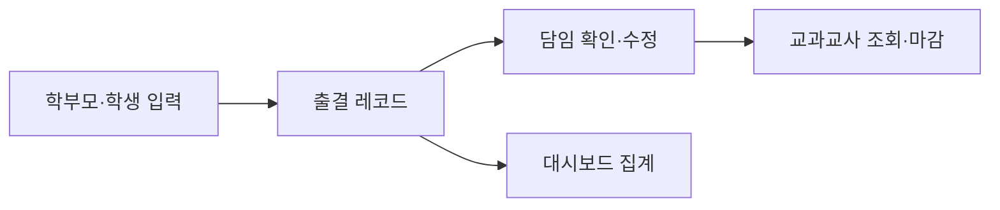

# Architecture

## 사용자 흐름

## 데이터 모델

### Student

- 학생 식별 정보
- 학급·번호 등 조회에 필요한 최소 속성

### AttendanceRecord

- 학생
- 날짜
- 제출자 역할
- 유형: 인정·질병·미인정
- 분류: 결석·지각·조퇴·결과
- 교시 범위
- 사유

## 설계 원칙

1. 같은 사실을 여러 화면에서 다시 입력하지 않는다.
2. 유효하지 않은 출결 조합은 UI에서 선택할 수 없게 한다.
3. 다수 학생 입력도 학생별 레코드로 저장한다.
4. 제출자 역할을 남겨 운영 중 오류를 추적할 수 있게 한다.
5. 실제 학생 정보와 인증정보는 공개 저장소로 이동하지 않는다.
